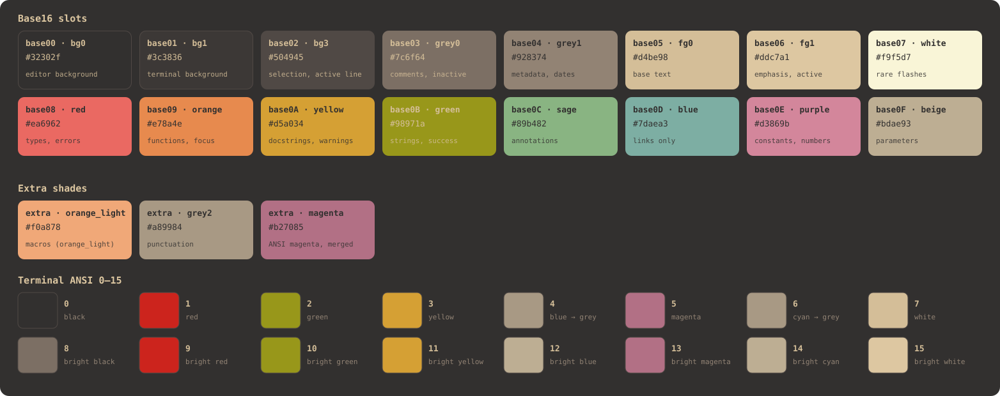
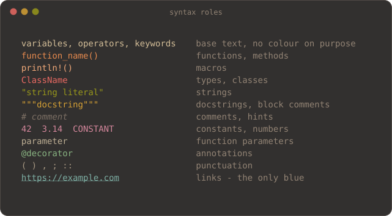
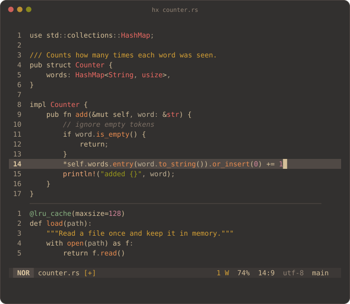
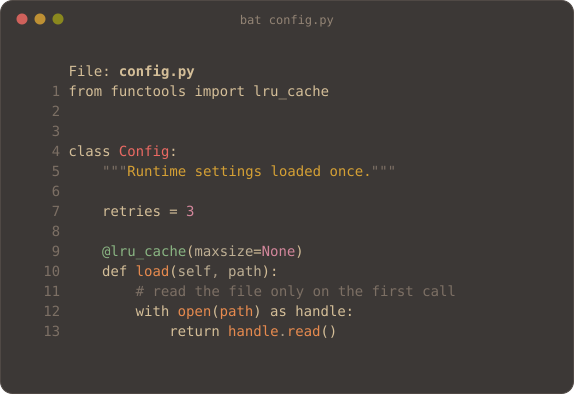
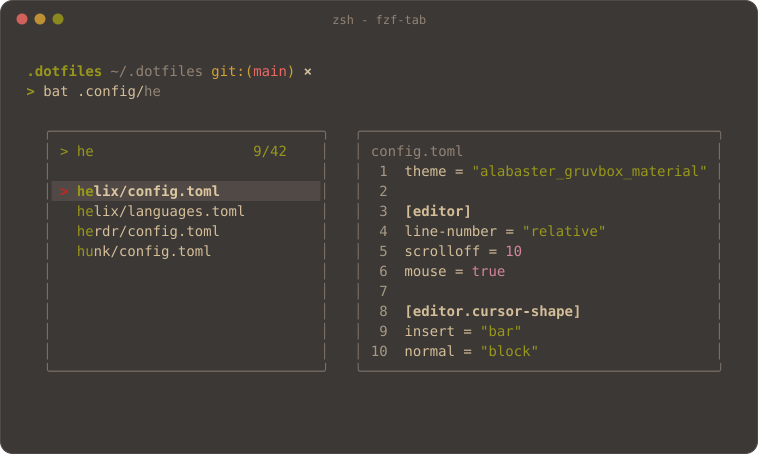
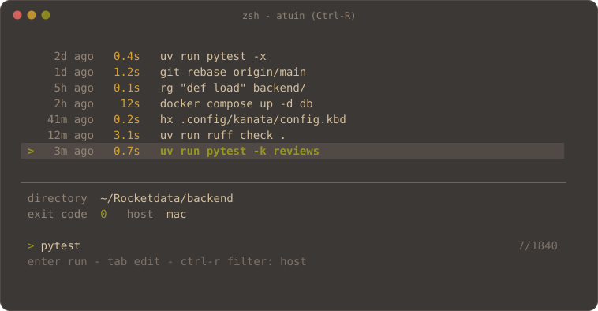
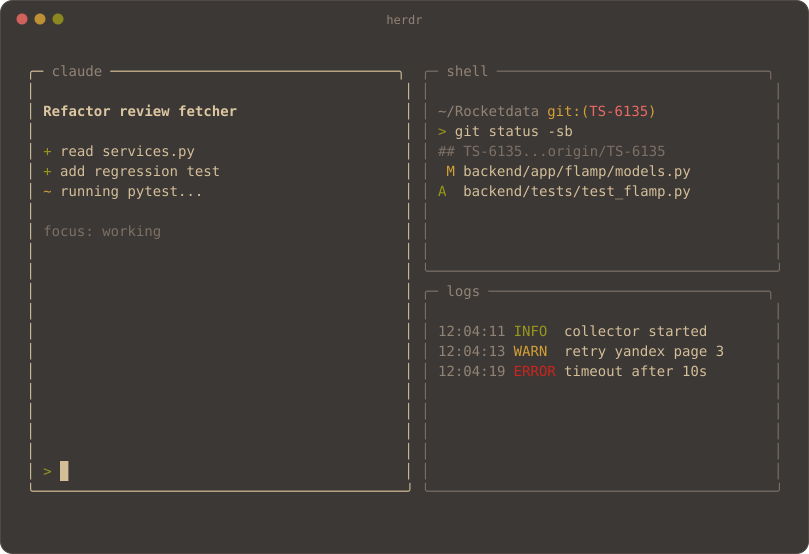
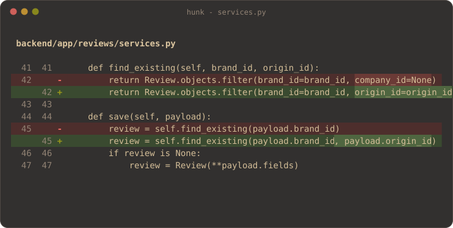
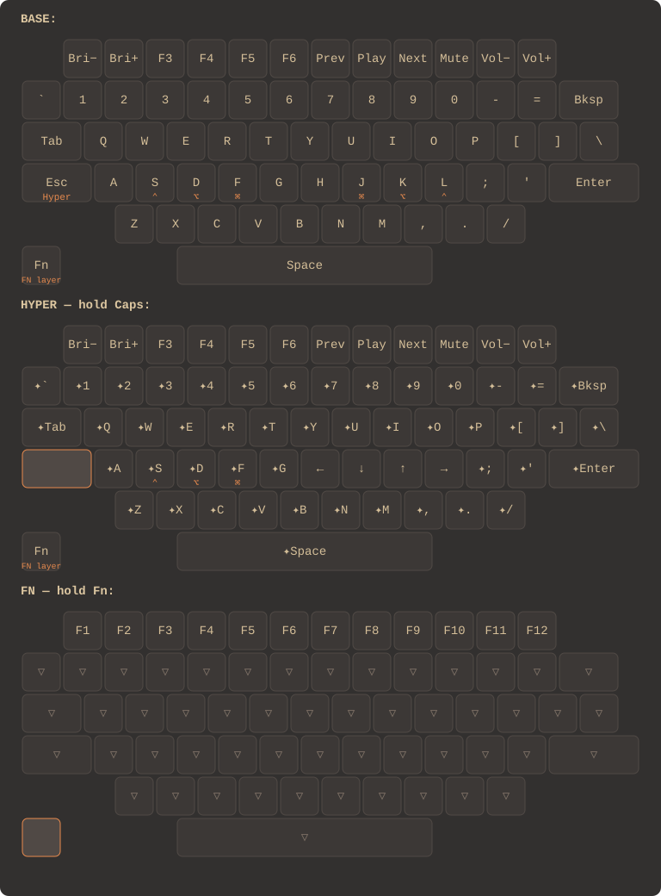

<h1 align="center">.dotfiles</h1>

<p align="center">
  A quiet, warm terminal setup: one palette across every tool, home-row mods on the laptop keyboard,<br>
  a minimal Helix and a translucent Ghostty.
</p>

- [Palette](#palette)
- [Terminal previews](#terminal-previews)
- [Helix](#helix)
- [Kanata](#kanata)
- [Ghostty](#ghostty)
- [Installation](#installation)
- [Regenerating the images](#regenerating-the-images)

---

## Palette

**Gruvbox Material Alabaster** - the Alabaster idea of minimal highlighting, drawn with Gruvbox Material colours on a transparent background. Colour is spent only on what carries meaning: functions, types, strings and status. Everything else is plain text.

Three rules hold the whole setup together:

- Keywords, operators and variables have no colour of their own. The eye catches only functions, types and strings.
- Blue (`#7daea3`) is allowed for links and footnotes only. Dates, directories and "main" accents are never blue or violet.
- One colour per role everywhere: an error is `#ea6962` in the editor, in the diff and in the prompt.

<p align="center">
  
</p>

The source of truth is [`.config/palette/PALETTE.md`](.config/palette/PALETTE.md); a machine-readable copy for base16 tooling is in [`base16-gruvbox-material-alabaster.yaml`](.config/palette/base16-gruvbox-material-alabaster.yaml).

### Roles in code

<p align="center">
  
</p>

| Role | Colour | Slot |
|---|---|---|
| Variables, operators, keywords, brackets | `#d4be98` | base05 |
| Functions, methods | `#e78a4e` | base09 |
| Macros (`println!`) | `#f0a878` | orange_light |
| Types, classes, constructors | `#ea6962` | base08 |
| Strings | `#98971a` | base0B |
| Docstrings, block comments | `#d5a034` | base0A |
| Comments, hints | `#7c6f64` | base03 |
| Constants, numbers | `#d3869b` | base0E |
| Parameters | `#bdae93` | base0F |
| Annotations, decorators | `#89b482` | base0C |
| Punctuation | `#a89984` | grey2 |
| Links, footnotes | `#7daea3` | base0D |

Markdown headings climb a four-colour ladder - red, orange, yellow, green - and every level after that is plain bold text.

### Terminal ANSI colours

The 16 ANSI slots are set in [Ghostty's theme](.config/ghostty/themes/gruvbox_material_alabaster.conf). Slots 4 and 6 (blue and cyan) are deliberately grey, because applications paint "just blue" for directories, dates and headings; a real link gets an explicit `#7daea3` instead. Bright red, green and yellow equal the normal ones: one colour per role. Bright white is `#ddc7a1`, not pure cream, so bold text does not jump out of the warm palette.

### Where it is applied

| Tool | File |
|---|---|
| Helix | [`.config/helix/themes/alabaster_gruvbox_material_dark_soft.toml`](.config/helix/themes/alabaster_gruvbox_material_dark_soft.toml) |
| Ghostty | [`.config/ghostty/themes/gruvbox_material_alabaster.conf`](.config/ghostty/themes/gruvbox_material_alabaster.conf) |
| bat | [`.config/bat/themes/gruvbox-material-alabaster.tmTheme`](.config/bat/themes/gruvbox-material-alabaster.tmTheme) |
| atuin | [`.config/atuin/themes/gruvbox-material-alabaster.toml`](.config/atuin/themes/gruvbox-material-alabaster.toml) |
| herdr | [`.config/herdr/config.toml`](.config/herdr/config.toml) |
| hunk | [`.config/hunk/config.toml`](.config/hunk/config.toml) |
| yazi | [`.config/yazi/theme.toml`](.config/yazi/theme.toml) |
| superfile | [`Library/Application Support/superfile/theme`](Library/Application%20Support/superfile/theme/gruvbox-material-alabaster.toml) |
| leaf | [`.config/leaf/alabaster_gruvbox_material_dark_soft.toml`](.config/leaf/alabaster_gruvbox_material_dark_soft.toml) |
| oh-my-posh | [`.config/ohmyposh/prompt.toml`](.config/ohmyposh/prompt.toml) |
| fzf | `FZF_DEFAULT_OPTS` in [`.zshrc`](.zshrc) |

---

## Terminal previews

Each image shows how a tool looks with this palette. The `bat` picture is real `bat` output rendered with the installed theme; the others are drawn from the palette roles and the tools' own colour settings, so they are faithful illustrations rather than screenshots.

### Helix (`hx`)

Functions are orange, types red, strings green, docstrings yellow. Keywords stay plain on purpose.

<p align="center">
  
</p>

### bat

<p align="center">
  
</p>

### fzf-tab

Completion opens in a popup with `bat` as the preview. Border and gutter are grey, the pointer is red, matches are green.

<p align="center">
  
</p>

### atuin

Time and duration use the metadata greys and yellow, never blue. The selected command is green.

<p align="center">
  
</p>

### herdr

The active pane has a light `#d4be98` border; inactive panes drop to brown-grey `#7c6f64`.

<p align="center">
  
</p>

### hunk (diffs)

Added and removed lines have a dark tinted background, changed words a stronger one, so changes read at a glance without drowning the text.

<p align="center">
  
</p>

---

## Helix

Config: [`.config/helix/config.toml`](.config/helix/config.toml), languages: [`languages.toml`](.config/helix/languages.toml). Theme: `alabaster_gruvbox_material_dark_soft`.

### Editor

| Setting | Value | Why |
|---|---|---|
| `line-number` | `relative` | jump with counts like `5j` |
| `scrolloff` | `10` | the cursor stays away from the edges |
| `cursorline` | off | less noise, the line number tells where you are |
| `auto-save` | on focus lost and 1 s after the last change | no manual `:write` |
| `cursor-shape` | bar in insert, block in normal, underline in select | the mode is visible at the cursor |
| `indent-guides` | `▏`, all levels | structure at a glance |
| `file-picker` | shows hidden files, ignores `.gitignore` | `Space f` finds everything |
| `lsp` | signature help on, inlay hints off | help when needed, no clutter |
| `inline-diagnostics` | `hint` on the cursor line | one message, not a wall |
| `smart-tab` | on | `Tab` completes or indents |

The status line shows mode, file, modification marker, diagnostics, scroll position, cursor position, encoding and git branch.

### Keys

Normal mode, on top of the Helix defaults:

| Key | Action |
|---|---|
| `Ctrl-s` | write |
| `Ctrl-q` | quit |
| `Cmd-r` | reload all buffers |
| `Tab` / `Shift-Tab` | next / previous buffer |
| `Alt-w` | close buffer |
| `Ctrl-h` `j` `k` `l` | jump between splits |
| `y` `p` `P` `R` | yank and paste through the system clipboard |
| `X` | extend the selection to the line above |
| `E` / `B` | end of line / first non-blank character |
| `Alt-f` | jump to the name of the enclosing function |
| `Alt-t` | jump to the name of the enclosing class or type |
| `Ctrl-f` | jump to the first `name(` on the line |
| `Alt-c` | copy the file name |
| `Ctrl-Backspace` | revert the change under the cursor |
| `g b` | git blame of the current line: commit, author, date, files touched |
| `g l` | full history of the current line |

Insert mode: `Ctrl-s` writes, `Ctrl-c` returns to normal mode, `Ctrl-e` goes to the end of the line, `Ctrl-l` moves right. In select mode `Tab` and `Shift-Tab` grow and shrink the selection.

The blame commands call small scripts from `~/.config/helix/bin` (`hx-blame-info`, `hx-blame-log`) that are not part of this repo.

### Python

Python uses [ty](https://github.com/astral-sh/ty) for types and [ruff](https://github.com/astral-sh/ruff) for lint (its diagnostics are switched off, so ty is the only source of errors). Auto-format is off. `debugpy` is wired in with two launch templates: run the current file, and a Django `runserver`.

---

## Kanata

[Kanata](https://github.com/jtroo/kanata) remaps the **MacBook's built-in keyboard** only (`macos-dev-names-include`), so external boards such as the TOTEM keep their own firmware. Config: [`.config/kanata/config.kbd`](.config/kanata/config.kbd).

Three ideas, nothing else:

1. **Home-row mods** - hold `S D F` and `J K L` for Ctrl, Alt, Cmd; tap for the letter.
2. **Hyper on Caps Lock** - tap for Esc, hold for a layer where every key sends `Ctrl+Alt+Cmd+Shift`.
3. **Fn layer** - the top row is media keys by default; hold `Fn` for real `F1-F12`.

<p align="center">
  
</p>

Orange legends are what a key does when held. In the HYPER layer `H J K L` become arrows and `S D F` stay modifiers, so window-management shortcuts can be pressed with one hand.

### How the config is built

```lisp
(defcfg
  process-unmapped-keys yes          ; keys not listed behave normally
  concurrent-tap-hold yes            ; several tap-holds can be pending at once
  rapid-event-delay 10               ; ms, ignore bounce between events
  macos-dev-names-include ("Apple Internal Keyboard / Trackpad"))
```

`defsrc` lists the physical keys that are remapped and every `deflayer` lists what they send, in the same order. `_` means "same as the layer below".

```lisp
(defvar tap-time 150  hold-time 190)

(defalias
  s (tap-hold-tap-keys $tap-time $hold-time s lctl (a s d f j k l ;))
  ;; d lalt, f lmet, j rmet, k ralt, l rctl follow the same pattern
  caps (tap-hold 200 200 esc (layer-while-held hyper)))
```

| Setting | Value | Meaning |
|---|---|---|
| `tap-time` | 150 ms | a press shorter than this is a tap |
| `hold-time` | 190 ms | a press longer than this is a hold |
| `tap-hold-tap-keys` | the home row | pressing another home-row key while a key is undecided makes it a tap, so fast rolls like `as` or `sd` never fire a modifier |
| Caps Lock | 200 / 200 ms | Esc on tap, HYPER layer on hold |
| Fn | 200 / 200 ms | `Fn` on tap, FN layer on hold |

Only `S D F J K L` carry modifiers. `A` and `;` (Shift) are left plain on purpose: Shift on the home row misfires too often, and the real Shift keys are always under the pinkies.

### Running

Kanata needs the Karabiner VirtualHIDDevice driver (installed with Karabiner-Elements) and root rights. The config is loaded at boot by a LaunchDaemon (`org.custom.kanata.plist`), which is machine-specific and not tracked here. To try the config by hand:

```sh
sudo kanata --cfg ~/.config/kanata/config.kbd
```

---

## Ghostty

Config: [`.config/ghostty/config`](.config/ghostty/config), theme: [`gruvbox_material_alabaster.conf`](.config/ghostty/themes/gruvbox_material_alabaster.conf).

| Group | Setting | Value |
|---|---|---|
| Look | `theme` | `gruvbox_material_alabaster.conf` |
| | `background-opacity` / `background-blur` | `0.8` / `20` - translucent glass |
| | `macos-titlebar-style` | `hidden` - no title bar, the window is just text |
| | `macos-window-shadow` | off |
| | `window-padding-x` / `y` | `15` / `10` |
| Text | `font-family` | DepartureMono Nerd Font |
| | `font-size` | `12` |
| | `adjust-cell-height` | `-10%` - tighter lines |
| | `cursor-style` | `bar` |
| Window | `window-width` x `window-height` | `100` x `35` cells |
| | `window-position-x` / `y` | `315` / `150` - opens in the same place |
| | `window-save-state` | `never` - always a fresh window |
| | `confirm-close-surface` | off |
| Behaviour | `macos-option-as-alt` | on - Alt works in Helix and shells |
| | `mouse-hide-while-typing` | on |
| | `shell-integration-features` | `cursor,title,path,ssh-terminfo,ssh-env` |
| | `auto-update` | `check`, `stable` channel |
| Quick terminal | `keybind` | ``Cmd+` `` - global shortcut that toggles it |
| | `quick-terminal-position` / `size` | `center`, `50%` x `30%` |

The theme sets the foreground to `#d4be98`, the background to `#3c3836` and the selection to `#504945`. The cursor is the base beige (not orange), so it does not compete with highlighted code.

---

## Installation

```sh
git clone git@github.com:PEPEtyam/dotfiles.git ~/.dotfiles
cd ~/.dotfiles

brew bundle --file=Brewfile      # tools, fonts and apps
stow .                           # symlink the configs into $HOME
bat cache --build                # register the bat theme
```

[GNU Stow](https://www.gnu.org/software/stow/) links everything except the paths in `.stow-local-ignore` (this README, `docs/`, `Brewfile`).

## Regenerating the images

The previews are plain SVG generated from the palette, so they stay in sync with it.

```sh
python3 docs/build_previews.py   # palette, roles, helix, bat, fzf-tab, atuin, herdr, diff
sh docs/build_kanata.sh          # kanata layers (needs uv, draws with keymap-drawer)
```

The Kanata drawing is described by [`docs/kanata/keymap.json`](docs/kanata/keymap.json), which mirrors `config.kbd`. Update it when the layers change.
